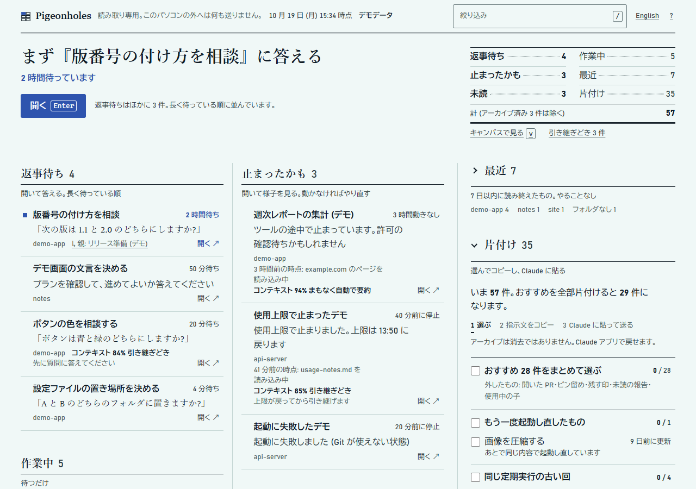

# Pigeonholes

Claude Code・Codex CLI・GitHub Copilot・OpenCodeのローカルセッションを同じ盤面に並べ、明示確認後にGit worktreeを操作できるローカルツールです。セッションデータは読み取り専用です。Claudeのセッションは6つの欄に分け、ほかの実行元は安全なイベント要約を表示します。一覧のほか、プロジェクトごとに用紙を並べたキャンバスでも見られます。

[English](README.md)

> 非公式のコミュニティ製ツールです。Anthropic とは関係がなく、Anthropic の承認やサポートも受けていません。Claude は Anthropic の商標です。



デモデータです。ほかに: [キャンバス](docs/screenshot-canvas.png) · [ダークテーマ](docs/screenshot-dark.png) · [幅 400px](docs/screenshot-narrow.png) · [英語](docs/screenshot.png)

- **セッションデータは読み取り専用**: アプリのセッションファイルには書き込みません。別のローカルworktreeは、対象を確認して画面で明示操作したときだけ作成します。127.0.0.1 だけで待ち受け、Pigeonholes自身は外部サービスへ通信しません。確認後のworktree作成時に、リポジトリ設定のcheckout filterが実行される場合があります。
- **裏に AI はいません**: 欄・ラベル・コンテキスト量・キャンバスの配置は、すべて決まった規則で出します。モデルにもどこにも何も送りません
- **依存パッケージ 0 個**: Node.js 22 以上だけで動きます。ビルドも不要です
- **日本語と英語**: 画面はブラウザの言語、ターミナルの表示は OS の言語に合わせます

## 使い始める

Node.js 22 以上と、Claude Code・Codex CLI・GitHub Copilot・OpenCode のいずれかのローカル保存先が必要です。OpenCodeの読込にはNode.js 22系は22.18以降、または24.4以降が必要です。

```sh
npx pigeonholes
```

clone して動かすなら:

```sh
git clone https://github.com/BERORINPO/pigeonholes.git
cd pigeonholes
npm start                       # node src/entry/server.mjs と同じ
```

npm の script にフラグを渡すときは `--` を挟みます: `npm start -- --port 8798`、`npm run demo -- --lang en`。挟まないと npm がフラグを受け取ってしまいます。`node src/entry/server.mjs --port 8798` なら不要です。

ターミナルに `Pigeonholes: http://127.0.0.1:8797 (セッション読み取り専用・worktreeは確認後)` と出たら、そのアドレスをブラウザで開きます。初回の読み込みは数秒かかります。止めるときは Ctrl+C。`もう起動しています: http://127.0.0.1:8797 を開いてください` と出たら、同じ種類のボードがすでに動いています。そのままアドレスを開いてください。そのポートで動いているのがデモで、自分のセッションを見ようとした (またはその逆) ときは、そう伝えて別の番号での起動例を出します。

自分のセッションを読まずに試すなら `--demo` を付けます (合成データ):

```sh
npx pigeonholes --demo          # clone からなら: npm run demo
```

ヒント: Claude デスクトップアプリには内蔵ブラウザがあります。そこでアドレスを開くと、会話の横にボードを置いておけます。一覧もキャンバスも幅 400px ほどでも崩れません。内蔵ブラウザではデスクトップ通知が使えず、**開く** が止められることがあります。そのときは詳しくの **リンクをコピー** を使うか、普段のブラウザで開いてください。

## 読むもの

セッション一覧と会話ログは読み取り専用で開きます。アプリの設定・Cookie・認証情報も読みません。画面で確認したworktree作成では、選択したローカルGitリポジトリの隣に新しいブランチと作業ツリーだけを書き込みます。セッションファイルは変更せず、CLIセッションも起動しません。

| 何を | Windows | macOS | Linux |
|---|---|---|---|
| セッション一覧 (`<アカウント>/<組織>/local_*.json`、`archived-sessions.idx`) | `%APPDATA%\Claude\claude-code-sessions`、次に Microsoft Store 版の `%LOCALAPPDATA%\Packages\Claude_pzs8sxrjxfjjc\LocalCache\Roaming\Claude\claude-code-sessions` | `~/Library/Application Support/Claude/claude-code-sessions` | `$XDG_CONFIG_HOME/Claude/claude-code-sessions`、次に `~/.config/Claude/claude-code-sessions` |
| 会話ログ (`<id>.jsonl`) | `%USERPROFILE%\.claude\projects` | `~/.claude/projects` | `~/.claude/projects` |
| Codex CLI の記録 (`rollout-*.jsonl`) | `%USERPROFILE%\.codex\sessions\YYYY\MM\DD` | `~/.codex/sessions/YYYY/MM/DD` | `~/.codex/sessions/YYYY/MM/DD` |
| GitHub Copilot の記録 (`events.jsonl`) | `%USERPROFILE%\.copilot\session-state\<UUID>` | `~/.copilot/session-state/<UUID>` | `~/.copilot/session-state/<UUID>` |
| OpenCode DB (`opencode.db`) | `%USERPROFILE%\.local\share\opencode` | `~/.local/share/opencode` | `~/.local/share/opencode` |

- セッションフォルダは上の順に探し、最初に見つかったものを使います。`--sessions-dir` を付けると探しません
- Codex は `CODEX_HOME` があればその `sessions`、なければ `~/.codex/sessions` を使います。CLI セッションと印のある記録だけを対象にします。末尾の一部を読み、ターン開始・完了・中断のイベントコードと時刻だけを残します。プロンプト、メッセージ、ツールの入力・出力、環境変数、完全なパスは盤面の応答に含めません。未知のイベントや壊れた行は読み飛ばします
- フッターの「読み込みの状態」を開くと、Codex の候補・認識件数と状態別件数を確認できます。0件の場合は、rollout が無い、CLI形式条件に合うファイルが無い、または新しい未完了ターンが無い、のどれかを説明します。15分以上更新のない未完了ターンは「止まったかも」、完了・中断は「最近」に表示されます。
- Copilotは `COPILOT_HOME/session-state`、未設定なら `~/.copilot/session-state` を読みます。Copilot CLIとCopilotアプリは保存先を共有するため、どちらが作ったかは判定せず「GitHub Copilot」と表示します。許可したイベント種別と時刻だけを保持し、不明な形式や壊れた行は除外します。「読み込みの状態」で対象ファイルがない場合や識別情報が一致しない場合を確認できます。
- OpenCodeは `OPENCODE_DB` があればそのDBを、なければ絶対パスの `XDG_DATA_HOME` の下の `opencode/opencode.db` を読みます。未設定または相対パスなら `~/.local/share/opencode/opencode.db` を使います。リリースチャンネルで保存場所が異なる場合は `OPENCODE_DB` を指定してください。Node組み込みSQLite APIのread-onlyモードを使います。`session_v2` / `session_message` では、セッション時刻、不透明ID、許可したuser/idle状態コードと時刻だけを使います。旧 `session` 形式では、安全な一覧用カラムだけを読み、状態とイベントは不明のままにします。履歴テーブルは読みません。プロンプト、ツールデータ、`auth.json`、DBパスは返しません。未知形式は除外し、「読み込みの状態」でDB未検出・形式非対応・旧形式・Node非対応を説明します。組み込みSQLite APIはNode.jsで実験的機能です。
- 会話ログ: `CLAUDE_CONFIG_DIR` があれば `$CLAUDE_CONFIG_DIR/projects` を使います。読むのは 7 日以内に動いたセッションの末尾だけです: 末尾 200KB、その中に使える行やトークン数が無いとき (とても長いツールの出力など) だけ 1 回、末尾 2MB。バックグラウンドのエージェントは `<id>/subagents/` の下のファイルの更新時刻だけを見て (最近書かれたファイルの数も数えます)、中身は開きません
- 会話ログの末尾から使うのは次のものだけです: 最後のターンの状態 (Claude が質問しているときはその質問)、時刻、最後の返答と自動要約のトークン数、ツールの名前、編集・作成・読み込み中のファイルの名前 (フォルダは除く)、コマンドのプログラム名と、npm や git などではそのサブコマンド (`npm test`、`git log`。パス・フラグ・値は出しません)、Web ページのホスト名、コネクタの名前、進行中の手順、Claude が最後のシェルコマンドに付けた短い説明。ツールの結果と、ほかの入力は残しません。ファイル名・手順・説明は先に掃除してから使います ([していること](#していること))
- セッションのモデル名は、コンテキストの窓の大きさを推定するためだけに読みます。画面には出さず、ページにも届きません
- アプリが記録した、そのセッションがコンテキストを使い切った回数 (数だけ)。止まったセッションに **新しいセッション用にコピー** を出すかを決めるためだけに使います
- セッションが動いていたフォルダ (アーカイブ済みは除く): そこか上の階層に `.git` があるかと、直下のフォルダ名だけを見ます。プロジェクト名を決めるためです。ネットワークのパス (`\\server\share`・`//server/share`) は見ません。割り当てたネットワークドライブ上のフォルダは普通のパスに見えるので、確かめるときに OS がその共有へ見に行くことがあります (1 つにつき 0.5 秒で打ち切ります)
- 作業フォルダの完全なパスはローカル adapter 内でだけ使い、API と画面には送りません。代わりにプロジェクト名を表示します
- 最近の未アーカイブセッションの作業フォルダを最大20件まで、上限時間つきの読み取り専用 Git コマンドで調べます。ブランチ、追跡中の変更・未追跡ファイル・競合の件数、ロック中・整理候補かを表示します。リポジトリやworktreeのパス、ファイル名、ロック理由はAPIと画面に送りません。デモのGit状態は合成データです
- セッション詳細から、同じリポジトリ内のローカルworktree最大20件を読み取り専用で更新表示できます。ブランチ、現在のセッションか、状態件数、ロック中・整理候補かを示し、パス・ファイル名・ロック理由はGit adapter内に留めます。
- セッション詳細の「worktreeを作成」では、新しいブランチ名と確認チェックを求めます。選択セッションの現在のHEADからリポジトリの隣にworktreeを作ります。未コミット変更は引き継ぎません。Git hookは無効にしますが、リポジトリのcheckout filterは実行される場合があります。パスとGit診断はローカルに留めAPIへ返しません。合成デモでは作成できません。
- 作成に成功すると、ブランチ・基点・作成時の安全な状態をworktreeカードに記録し、元セッションへつなぎます。記録はブラウザ内だけに保存するスナップショットです。カードを編集・削除してもGit上のworktreeは変わりません。
- 使わない項目 (MCP サーバーの設定など) は読んだ直後に捨て、画面には届きません
- 画面での選択は、このブラウザの保存領域に覚えておきます: 言語・1 文字キーと通知の切替・表示 (一覧かキャンバスか)・開いた欄とプロジェクトのまとまり・キャンバスの用紙の位置・カードと関係・引き継ぎの指示文をコピーしたセッション (セッション ID と時刻と %。24 時間で消します)。グラフのカードと関係はブラウザ内だけに保存し、セッション本文は複製しません。プロジェクトはフォルダ名で覚えます。盤面から無くなったプロジェクトのまとまりは消し、用紙の位置は 7 日間だけ残します

## 6 つの欄

| 欄 | 意味 | すること |
|---|---|---|
| 返事待ち | Claude が質問している・プランの承認を待っている・あなたの対応が要ると言っている | 開いて答える。長く待っている順 |
| 止まったかも | エラー・使用上限・起動の失敗・15 分以上動きなし | 開いて様子を見る。動かなければやり直す |
| 未読 | 終わったが、結果をまだ開いていない | 開いて読む |
| 作業中 | いま動いている | 待つ |
| 最近 | 7 日以内に読み終えたもの | なし |
| 片付け | 7 日以上動きなし・定期実行の古い回・やり直した前の回・PR がすべてマージかクローズ済み | 選んで指示文をコピーし、Claude に貼る |

一番上の 1 文が「まず見る 1 件」です。欄ごとの件数の一覧 (広い画面では右、狭い画面では一番上の 1 文の下) で件数が分かります。**開く** でそのセッションを Claude アプリで開きます。タイトルを押すと詳しく (していること・コンテキスト・要約の全文・プロジェクト名・ブランチ・worktree状態・PR・親子、ID やリンクのコピー) が出ます。作業フォルダの完全なパスは表示しません。画面が見えている間は 5 秒ごとに更新します。返事待ちと止まったかもをデスクトップ通知で知らせる機能は、フッターで自分で ON にするまで動きません。

## していること

作業中の行 (とキャンバスの付箋) には、そのセッションがいま何をしているかの短い 1 行が付きます。最後に使ったツールから作ります: 「board.mjs を編集中」「テストを実行中 (npm test)」「example.com のページを読み込み中」「サブエージェント 2 件が作業中」「考えています」。止まったかもの行には、静かになったときに何をしていたかが出ます: 「3 時間前の時点: notes.md を読み込み中」。

Claude が自分で短い言葉を書いているときは、それも出します: いま取り組んでいる手順 (手順: 仕様を書く) と、最後のシェルコマンドに付けた説明 (「単体テストを実行」のようにかぎかっこ付き)。出す前にこの言葉は掃除します: 制御文字と見えない文字は消し、Web のアドレスはホスト名だけ、絶対パスはファイル名だけを残し、ID・メールアドレス・鍵、パスワードやトークンらしいものは伏せ字にし、40 文字で切ります。この言葉が出るのはこのパソコンの画面の中だけです。

## コンテキストと引き継ぎ

7 日以内に動いたセッションには、コンテキストがどれだけ埋まっているかが出ます。最後の返答が使ったトークンが、コンテキストの窓のどれだけかです (アプリの円と同じ数)。行には最初の段階から出し、詳しくには段階に関係なくトークン数と一緒に出します。文字と太さだけで、バーや色は使いません (キャンバスには小さな目盛りが付きます):

| 段階 | 1M の窓では | 出る言葉 |
|---|---|---|
| 目安 | 約 58% から | `コンテキスト 62%` (薄い文字) |
| 引き継ぎどき | 約 80% から | `コンテキスト 82% 引き継ぎどき` (太字) |
| まもなく | 約 90% から | `コンテキスト 92% まもなく自動で要約` (太字) |

段階は「Claude が会話を自動で要約する点」(1M の窓で約 97%) に対する割合で決めているので、200K の窓では早めに来ます (約 50%・69%・77%)。窓の大きさが推定のときは `コンテキスト 約 62%` と出ます。要約のあと 1 時間は `5 分前に要約済み` と出ます。件数の下の **引き継ぎどき N 件** を押すと、いま引き継げるセッションへ、埋まっている順に移ります。

コンテキストが埋まると、Claude は会話を自動で要約し、細かい指示が抜けることがあります。その前に引き継げば、大事なことが残ります: 全部を覚えているうちにそのセッションが引き継ぎ文を書き、新しいセッションはその引き継ぎ文から始めます。

1. 「引き継ぎどき」以上の未読・最近の行 (24 時間以内に動いたもの) で **引き継ぐ** を押すか、その行で `h` を押します (未読と最近の行なら、`h` は段階に関係なく使えます)。詳しくが開いて、短い手順が出ます
2. **コピーして開く** を押します。ボードが指示文をコピーし、そのセッションを Claude アプリで開きます
3. 開いたセッションに貼って送ります
4. Claude が区切りのよいところで止まり、引き継ぎ文を書いて見せます。新しいセッションがどこで作業するかと、あとで古いセッションをアーカイブすると新しい方も一緒にアーカイブされるかも書きます。そのうえで、新しいセッションを始めてよいかを 1 回だけ聞きます (アプリの新しいセッションのカードが使えるならそれで)
5. アプリで承認するか断ります。新しいセッションはボードに出ます (アプリが 2 つをつないでいれば、古い方の子として)。古い行には `3 分前に引き継ぎの指示文をコピー` と出て、コンテキストがさらに 5 ポイント増えるか、要約されるか、24 時間たつまで続きます

**引き継ぎは指示文のコピーだけにする理由**: ボードはセッションに文字を打ち込んだり、アプリのボタンを押したりしません。承認はいつもあなたがアプリで行い、作業はすべてを知っているそのセッションの Claude がします。コピーする文には % しか入りません (タイトルも ID も入らず、ツールの名前も書いていません)。下の **新しいセッション用にコピー** だけは、止まったセッションの ID も入ります。

作業中 (貼るとターンに割り込みます)・返事待ち (質問に答えてしまいます)・使用上限で止まったセッションには **引き継ぐ** を出しません。代わりに行に「終わってから引き継げます」「先に質問に答えてください」「上限が戻ってから引き継げます」と出ます。コンテキストがいっぱいで答えられないかもしれない止まったかものセッションには、代わりに **新しいセッション用にコピー** が出ます: 同じフォルダで新しいセッションを作り、そこに貼って送ります。この文には止まったセッションの ID が入っていて、新しいセッションがその最近の会話を (読むだけで) 読み、引き継ぎ文を書きます。

<details>
<summary>コピーする引き継ぎの指示文</summary>

```
この会話のコンテキストは約 {pct}% まで埋まっています。この作業を新しいセッションで続ける準備をしてください。私が承認するまで、新しいセッションは始めないでください。
1. 区切りのよいところで止めてください。準備の間、ファイル・設定・ほかのセッションは変更せず、このセッションもアーカイブしないでください。もう引き継ぎ済みなら、引き継ぎ先だけ教えて止まってください。
2. 新しいセッション向けの引き継ぎ文を書いてください: 目的、終わったこと、途中のこと (ファイル・ブランチ・未コミットの変更)、決めたことと理由、次の手順、未解決の点。
3. 引き継ぎ文を見せてください。新しいセッションがどこで作業するか (このフォルダか、新しい worktree か) と、あとでこのセッションをアーカイブすると新しい方も一緒にアーカイブされるかも書いてください。そのうえで、始めてよいかを 1 回だけ聞いて待ってください (アプリの新しいセッションのカードが使えるならそれで)。
4. 承認したときだけ: 新しいセッションを 1 つ、まっさらなコンテキストで始めてください (この会話のフォークではなく)。引き継ぎ文をその作業内容にします。セッションを始められない場合は、貼り付け用に引き継ぎ文を 1 つのコードブロックで渡してください。
5. 断ったら何もしないでください。ここで要約したいと言ったら、/compact の後に打つ 1 行を教えてください。
これ以外のことはしないでください。
```

</details>

## キャンバス


`v` (または件数の下の **キャンバスで見る**) で、同じ盤面を机に紙を並べた形で見られます。プロジェクトごとに 1 枚の用紙、見る必要のあるセッション (返事待ち・止まったかも・未読・作業中) ごとに 1 枚の付箋です。もう一度 `v` で一覧に戻ります。最後に使った表示を覚えておきます。

- **配置は決まった規則で、AI ではありません**: 用紙は急ぐ順に並びます。一番長くあなたを待っているセッションのあるプロジェクトが左上です。用紙の中では返事待ちと止まったかもが先頭に来て、次に未読と作業中です (一覧と同じ順)。子のセッションの付箋は親の名前を言います (「↳ 親: …」)。最近と片付けは用紙の下の 1 行 (「最近 4　片付け 13」) で、押すと一覧のその欄を開きます。片付けのセッションしか無いプロジェクトは、用紙の下の 1 つのまとめに並びます。付箋の行の高さは中身に合わせます。同じ盤面なら毎回同じ絵になるので、どこに何があるかを覚えられます
- **拡大の 3 段階**: 遠く (60% 未満): 印と、プロジェクト名の横に「要対応」の件数。中くらい: タイトル・時間・作業中と止まったかもの短い説明、必要なときはコンテキスト。近く (100% 以上): さらにブランチ・worktree・PR・親・質問やしていることの全文・**開く** と **引き継ぐ**。狭い画面 (Claude の横の欄) は近くで開き、縮小するとすぐ遠くになります
- **見て回る**: 机をドラッグするかホイールで移動、Ctrl+ホイールかピンチで拡大縮小。開いたときは急ぐ用紙を左上から、用紙が画面の幅に収まる大きさで表示します。`f` で全体、`z` で全体と元の表示を往復、`+` `−` で拡大縮小、`0` で 100%
- **用紙を動かす**: プロジェクト名をドラッグするか、押すと出る動かすボタンを使います (名前の上で Shift と矢印でも同じ)。ほかの用紙は場所を空けるために下へずれるだけで、横には動きません。位置はこのブラウザに覚え、新しいプロジェクトはほかを動かさずに空いた場所に入ります。**並べ直す** で全体を並べ直します
- **カードと関係**: タスク・成果物・判断・理解負債・実行条件・Obsidianノート参照カードを追加し、ドラッグまたは矢印キーで動かせます。セッションや別カードと関係線で結び、検索・編集・再読み込み後の復元ができます。Obsidian参照はvault名とvault内の相対ノート名だけを手動入力して、このブラウザーに保存します。vault走査やノートの読書きはせず、`obsidian://`リンクを選んだときだけObsidianを開きます。関連セッションの詳細からも、明示リンクでノートを開けます。REAの所見は、ユーザーが確認した短い要約を成果物カードに手動記録し、関連タスク・判断・セッションへ結びます。PigeonholesからREAを実行したり、完全なEvidenceを取り込んだりしません。実行条件は場所・作業領域の分離・ネットワーク・承認方式を固定選択肢で手動記録し、初期値はすべて「不明」です。セッションや環境から自動検出しません。成果物カードには、認証情報・クエリ・フラグメントを含まないHTTPS参照を付けられます。参照先は取得せず、リンクを選んだときだけ別タブで開きます。関係の目的や委譲状態を編集でき、確認後に関係だけを解除できます。理解負債には、理解を確認される人、不足する根拠、必要な説明を記録します。理解度スコアは作りません。委譲の線は記録だけで、エージェントや CLI を起動しません
- 未解決の理解負債に不足根拠または必要な説明が明記されているのに対応する `evidence` / `explains` 関係がない場合、キャンバスに未接続と表示します。これはグラフ上の関係不足だけを示し、人の理解度を判定しません
- 関連付けた理解負債はセッション詳細でも、理解を確認される人・不足する根拠・必要な説明と、`evidence` / `explains` でつながるカードやセッションを確認できます。接続先ボタンで該当カードまたはセッション詳細へ移動できます。理解度の推定やスコアは表示しません
- セッション詳細には関連カード、関係の種類、委譲の記録状態、目的・根拠を表示します。関連する実行条件カードの4項目も手動記録として表示し、実際の実行環境を検証した情報とは扱いません。カードを選ぶと詳しい内容を開けます
- セッション詳細には Claude Code または Codex CLI のハーネス名を表示します。環境変数などの実行設定は取り込みません
- **下の帯**には凡例・拡大縮小・全体を表示があります (全体を表示は 30% より小さくしません。名前が読める大きさで、長い机は動かして読みます)。タイトルを押す (または Space) とそのセッションの詳しくがここに出て、**引き継ぐ** で引き継ぎの手順もここに出ます
- 絞り込みは、合わないものを薄くするだけで動かしません。選ぶ・片付ける操作は一覧で行います
- **絞り込み**を開くと、実行元・状態・プロジェクトを文字検索と組み合わせられます。実行元は Claude Code / Codex CLI / GitHub Copilot / OpenCode、プロジェクトは安全な表示名から選びます。一覧は一致する行だけを表示し、キャンバスは一致しない付箋を薄くして用紙の位置を保ちます

キャンバスは版 0.1 の「全体」表示の代わりです。

## キー

| キー | 一覧 | キャンバス |
|---|---|---|
| `j` / `k` | 次 / 前の行 | 次 / 前のセッション (用紙ごとの順) |
| `Enter` か `o` | Claude アプリでセッションを開く | 同じ |
| `Space` | 詳しくを出す / しまう | 帯に詳しくを出す / しまう |
| `h` | 引き継ぐ: 手順を開き **コピーして開く** に移る (Enter で押せます) | 同じ (帯で) |
| `v` | キャンバスへ | 一覧へ |
| `z` | キャンバスへ切り替えて全体を表示 | 全体と元の表示を往復 |
| `+` `−` `0` `f` | — | 拡大・縮小・100%・全体 |
| 矢印 | `↓` / `↑`: 次 / 前の行 | 付箋の上で: その向きの隣のセッション。それ以外: 移動 |
| `Shift` + 矢印 | — | プロジェクト名の上で: 用紙を動かす |
| `x` | 片付けの行を選ぶ / 外す | — |
| `a` | おすすめをまとめて選ぶ | — |
| `c` | 片付けの指示文をコピー (次の 50 件) | — |
| `/` | 絞り込み | 同じ |
| `1`〜`6` | その欄へ移動 | その欄の最初のセッションへ (`6` は一覧の片付けを開く) |
| `?` | キー一覧 | 同じ |
| `Esc` | 順に: ダイアログを閉じる・絞り込み欄から出る・詳しくを閉じる・絞り込みを解く | 順に: ダイアログを閉じる・絞り込み欄から出る・帯を閉じる・付箋やプロジェクト名から離れる・絞り込みを解く |

1 文字のキーは、`?` の画面の「一文字キーを使わない」でオフにできます。Enter・Space・Esc・Tab・矢印はそのまま使え、キャンバスのほかの操作は帯のボタンでできます。

## 古いセッションを片付ける (アーカイブ)

ボード自身は何も変えません。代わりに Claude への指示文を作ります。

1. 一覧の **片付け** で **おすすめ N 件をまとめて選ぶ** にチェックを入れる (行ごとに選んでもよい)
2. 下の帯の **指示文をコピー** を押す。50 件ずつコピーします。中身は 3 行の指示と、1 行に 1 つのセッション ID だけです (タイトルは入りません)
3. Claude デスクトップアプリのどれかのセッションに貼って送る。Claude がアーカイブし、アーカイブした件数と飛ばした件数を返します。承認を求められたら、その会話で許可してください
4. 次の更新で、アーカイブされた分はボードから消えます。帯に済んだ件数が出ます

指示文を渡すだけにしている理由: これらのファイルはアプリのもので、アプリがいつも書き換えています。外から書き込むとアプリの書き込みとぶつかり、ファイルを壊すおそれがあります。Claude を通せばアプリ自身の手順でアーカイブでき、一つずつ目で見て承認できます。

アーカイブしても消えません。Claude アプリからいつでも戻せます。PR が開いている・ピン留め・残す印・未読の報告・使用中の子があるものは、おすすめから外しています (手で選ぶことはできます)。アプリのファイル形式が変わったように見えるとき (日時の無いセッションが多いとき) は、おすすめを止めてお知らせを出します。

## 動作環境と互換性

- **公開されていないファイルを読みます**: デスクトップアプリの手元のファイルは公開 API ではありません。アプリの更新で形が変わると、ボードが動かなくなったり、違う欄に出たりします。トークン数が読めなくなったらコンテキストの表示を止め、ツールの使い方が読めなくなったら「していること」が出なくなります。どちらもフッターでお知らせします。アプリのバージョンを添えて issue で知らせてください
- **コンテキストの量は推定を含みます**: セッションのコンテキストの窓の大きさは、どのファイルにも書かれていません。モデル名 (`[1m]`)、会話ログから分かること、知られているモデルの系列から決め、推定のときは「約」と書きます。200K の窓で自動要約される点も推定です。とても大きなツールの結果が出た直後は、数が遅れることがあります
- **新しいセッションのカード**: 引き継ぎは、そのセッションの Claude がアプリの「新しいセッション」のカードで聞くことを前提にしています。これは公開の docs に無いアプリの機能です。カードが出ないときは、Claude が貼り付け用の引き継ぎ文をコードブロックで渡します
- **開くリンク**: **開く** はアプリの `claude://` リンクを使います。うまくいかない場合があります (ブラウザや内蔵の画面によっては止められます)。そのときは詳しくの **リンクをコピー** か **ID をコピー** を使ってください
- **OS**: Windows (Microsoft Store 版を含む) で開発しています。macOS のフォルダはアプリの標準の場所です。Linux の場所は未確認です。フォルダが違ったら知らせてください。テストは合成データで Windows・macOS・Linux で走らせています
- **リモートのセッション**: クラウドや別のマシンで動いたセッションは、このパソコンに会話ログが無いので、作業中・止まったかも・していること・コンテキストを判定できません。フッターに件数が出ます

## 設定

フラグは環境変数より優先します。`--flag value` と `--flag=value` のどちらでも書けます。

| フラグ | 環境変数 | 既定 |
|---|---|---|
| `--port <n>` | `PIGEONHOLES_PORT` | `8797` (1024〜65535) |
| `--lang en\|ja` | `PIGEONHOLES_LANG` | OS の言語。ターミナルの表示とデモの中身の言語 |
| `--demo` | `PIGEONHOLES_DEMO=1` | なし |
| `--sessions-dir <path>` | `PIGEONHOLES_SESSIONS_DIR` | 自動で探す ([読むもの](#読むもの) の順) |
| `--projects-dir <path>` | `PIGEONHOLES_PROJECTS_DIR` | `$CLAUDE_CONFIG_DIR/projects`、無ければ `~/.claude/projects` |
| — | `PIGEONHOLES_ROOTS` | ホームフォルダ。絶対パスを `;` 区切り (macOS と Linux は `:` も可)。git リポジトリの外で `<root>/<名前>/...` にあるセッションは `<名前>` にまとめます |
| `--help`, `--version` | — | — |

プロジェクト名は、セッションが動いている git リポジトリの名前です (`.claude/worktrees/` の下の worktree は元のリポジトリに数えます)。

画面のアドレスには `?lang=en` / `?lang=ja`、`?theme=light` / `?theme=dark`、`?view=list` / `?view=canvas` (これは覚えません) を付けられます。見出しの言語ボタンで選んだ言語は、このブラウザに覚えておきます。コンテキストの段階などのしきい値は `src/shared/constants.mjs` の定数です。設定画面はありません。

## 困ったとき

| 出たもの | 直し方 |
|---|---|
| `ポート 8797 は別のアプリが使っています` | 別のポートで起動します。メッセージにそのまま貼れるコマンドが出ます (例: `npx pigeonholes --port 8798`)。`--demo` など付けていたフラグはそのまま残ります |
| `ポート 8797 で動いているのはデモのボードで、あなたのセッションではありません` (またはその逆) | そのボードのターミナルで Ctrl+C で止めるか、出た別の番号のコマンドを貼ります |
| `Claude デスクトップアプリのセッションフォルダが見つかりません` | Claude デスクトップアプリの Code タブで一度セッションを始めるか、`--sessions-dir <path>` で場所を指定します。アプリのほかのタブの会話ではこのフォルダはできません。探した場所がメッセージに全部出ます |
| 画面に「サーバーにつながりません」 | ターミナルが閉じて止まっています。もう一度起動すると、画面は自動でつながります |
| **開く** を押しても何も起きない | ブラウザが `claude://` のリンクを止めています。詳しくの **リンクをコピー** か **ID をコピー** を使うか、別のブラウザで開きます |
| フッターに「通知が止められています」 | このブラウザではページの通知が許されていません (Claude の内蔵ブラウザなど)。通知を使うなら普段のブラウザで開きます |
| **指示文をコピー** や **コピーして開く** で入力欄が出る | 自動でコピーできない環境です。出た欄で Ctrl+C (Mac は Cmd+C) |
| 作業中のはずが **止まったかも** に出る | 許可の確認待ちか、15 分以上かかる処理の途中です。開けば分かります |
| ここで読んだのに **未読** のまま | Claude アプリで一度開くと消えます (ボードからは既読にできません) |
| コンテキストが埋まっているのに **引き継ぐ** が出ない | 出すのは未読と最近の行で、「引き継ぎどき」以上、24 時間以内に動いたものだけです。その行で `h` を押すと、理由が出るか手順が開きます |
| コンテキストに「約」が付く | 窓の大きさが推定です ([動作環境と互換性](#動作環境と互換性)) |
| フッターに「会話ログのフォルダが見つかりません」 | 作業中・止まったかも・していること・コンテキストには会話ログが要ります。`--projects-dir <path>` を付けるか `CLAUDE_CONFIG_DIR` を設定します |
| フッターに「コンテキスト量を読めない」「操作を読めない」 | 会話ログの形が変わったかもしれないので、その表示を止めています。アプリのバージョンを添えて issue で知らせてください |
| 「Claude アプリのファイル形式が変わったかもしれません」というお知らせ | 安全のためにおすすめを止めています。アプリのバージョンを添えて issue で知らせてください |

## 開発

```sh
npm test          # 単体・結合テスト (node:test。データはすべて合成)
npm run arch      # 依存の向き・禁止 API・「言葉は辞書だけ」の検査
npm run smoke     # このパソコンの実データを読み取り専用で読む (空いているポートで起動、件数だけを出す)
npm run demo      # 合成データでボードを起動
```

仕様: [spec/board.md](spec/board.md) (データと規則、日本語) / [spec/ui.md](spec/ui.md) (画面、英語) / [spec/design.md](spec/design.md) (見た目、英語) / [spec/architecture.md](spec/architecture.md) (構成と決定、日本語)。脆弱性の報告: [SECURITY.md](SECURITY.md)。変更履歴: [CHANGELOG.md](CHANGELOG.md)。

## ライセンス

[MIT](LICENSE)
