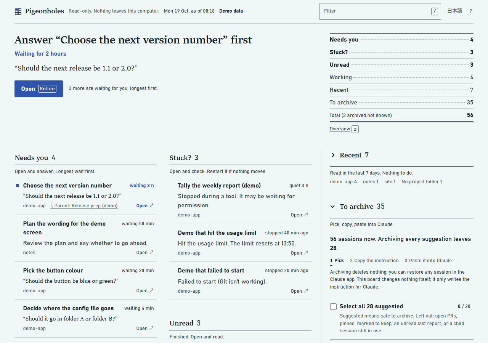
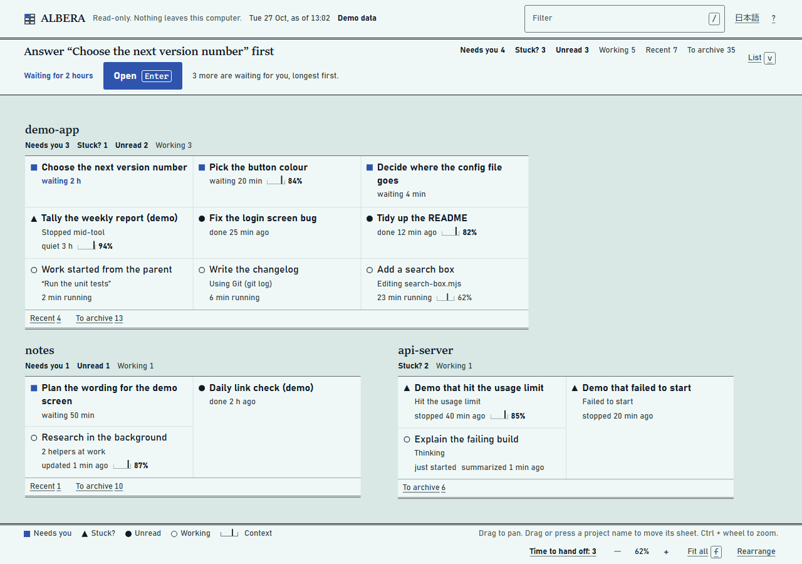

# Pigeonholes

A local board for Claude Code, Codex CLI, GitHub Copilot, and OpenCode sessions, with read-only session data and user-confirmed Git worktree operations. Claude sessions are sorted into six piles; other providers show safe event summaries. See the board as a list or as a canvas with one sheet per project.

[日本語](README.ja.md)

> Unofficial community tool. Not affiliated with, endorsed by, or supported by Anthropic. Claude is a trademark of Anthropic.



Demo data. Also: [canvas](docs/screenshot-canvas.png) · [dark theme](docs/screenshot-dark.png) · [400 px wide](docs/screenshot-narrow.png) · [Japanese](docs/screenshot-ja.png)

- **Session data stays read-only.** It never writes to app session files. A separate local Git worktree is created only after you review the target and confirm in the board. The board listens on 127.0.0.1; Pigeonholes itself does not contact remote services. Git checkout filters configured by a repository may run during a confirmed worktree creation.
- **No AI behind it.** Piles, labels, context sizes and the canvas layout come from fixed rules. Nothing is sent to a model or anywhere else.
- **Zero dependencies.** Node.js 22 or newer. No build step.
- **English and Japanese.** The page follows your browser language; the terminal follows your system language.

## Quick start

You need Node.js 22 or newer and a local Claude Code, Codex CLI, GitHub Copilot, or OpenCode session store. OpenCode reading needs Node.js 22.18 or newer in the 22 line, or Node.js 24.4 or newer.

```sh
npx pigeonholes
```

From a clone:

```sh
git clone https://github.com/BERORINPO/pigeonholes.git
cd pigeonholes
npm start                       # same as: node src/entry/server.mjs
```

npm needs `--` before flags for the script: `npm start -- --port 8798`, `npm run demo -- --lang en`. Without it, npm takes the flag for itself. `node src/entry/server.mjs --port 8798` works without it.

When the terminal prints `Pigeonholes: http://127.0.0.1:8797 (sessions read-only; worktrees on confirmation)`, open that address in a browser. The first scan takes a few seconds. Stop it with Ctrl+C. If it prints `Already running: open http://127.0.0.1:8797`, a board of the same kind is already up; open the address. If the board on that port is the demo and you asked for your sessions (or the other way round), it says so and prints a command for another port instead.

To try it without reading your sessions, add `--demo` (synthetic data):

```sh
npx pigeonholes --demo          # from a clone: npm run demo
```

Tip: the Claude desktop app has a built-in browser pane. Open the address there and the board sits next to your conversation. The list and the canvas both work down to about 400 px wide. In that pane, desktop notifications are not available, and **Open** may be blocked; then use **Copy link** in the details, or open the board in your usual browser.

## What it reads

Session lists and transcripts are opened read-only. Pigeonholes does not read app settings, cookies, or credentials. A confirmed worktree creation writes only a new sibling checkout and branch in the selected local Git repository; it does not change session files or start a CLI session.

| What | Windows | macOS | Linux |
|---|---|---|---|
| Session list (`<account>/<org>/local_*.json`, `archived-sessions.idx`) | `%APPDATA%\Claude\claude-code-sessions`, then the Microsoft Store location `%LOCALAPPDATA%\Packages\Claude_pzs8sxrjxfjjc\LocalCache\Roaming\Claude\claude-code-sessions` | `~/Library/Application Support/Claude/claude-code-sessions` | `$XDG_CONFIG_HOME/Claude/claude-code-sessions`, then `~/.config/Claude/claude-code-sessions` |
| Transcripts (`<id>.jsonl`) | `%USERPROFILE%\.claude\projects` | `~/.claude/projects` | `~/.claude/projects` |
| Codex CLI rollouts (`rollout-*.jsonl`) | `%USERPROFILE%\.codex\sessions\YYYY\MM\DD` | `~/.codex/sessions/YYYY/MM/DD` | `~/.codex/sessions/YYYY/MM/DD` |
| GitHub Copilot events (`events.jsonl`) | `%USERPROFILE%\.copilot\session-state\<UUID>` | `~/.copilot/session-state/<UUID>` | `~/.copilot/session-state/<UUID>` |
| OpenCode database (`opencode.db`) | `%USERPROFILE%\.local\share\opencode` | `~/.local/share/opencode` | `~/.local/share/opencode` |

- The first session folder that exists is used. `--sessions-dir` replaces the search.
- Codex uses `$CODEX_HOME/sessions` when `CODEX_HOME` is set; otherwise it uses `~/.codex/sessions`. Codex entries are limited to rollout files marked as CLI sessions. The board reads a bounded tail and keeps only turn start, completion, and interruption event codes and timestamps. It does not retain prompts, messages, tool inputs or outputs, environment values, or full paths in the board response. Unknown events and malformed rows are skipped.
- On Windows, WSL Codex sessions are opt-in: set `CODEX_HOME` to the `.codex` directory through that distro's `\\wsl.localhost\<distro>` or `\\wsl$\<distro>` share. Pigeonholes reads the configured share only; it does not enumerate distros or run WSL commands. Linux working directories are mapped internally for project-name detection, while the board returns only the `WSL` location label. Git worktree actions for WSL sessions are unavailable. This share-based path has synthetic-test coverage but has not been verified against a live WSL distro in this environment.
- Open **Reading status** in the footer for Codex candidate, recognized, and lifecycle counts. When a count is zero, it explains whether no rollout files were found, no files passed the CLI format checks, or no recognized session has a fresh unfinished turn. A stale unfinished turn is shown under Stuck?; completed and interrupted turns are under Recent.
- Copilot uses `$COPILOT_HOME/session-state` when `COPILOT_HOME` is set; otherwise it uses `~/.copilot/session-state`. CLI and Copilot app share this store, so Pigeonholes labels the provider GitHub Copilot without claiming which client produced a session. Only allowlisted event types and timestamps are kept; malformed rows and unknown event types are skipped. **Reading status** explains when no event files are present or none match the expected session identity.
- OpenCode reads `$OPENCODE_DB` when set; otherwise it honors an absolute `$XDG_DATA_HOME` and uses `<XDG_DATA_HOME>/opencode/opencode.db`, falling back to `~/.local/share/opencode/opencode.db`. If an OpenCode release channel stores data elsewhere, set `OPENCODE_DB` to that database. It opens the database with Node's built-in SQLite API in read-only mode. For `session_v2` / `session_message`, it keeps only session timestamps, opaque IDs, and allowlisted user/idle event codes and times. For the older `session` schema, it reads only safe session-list columns; status and events remain unknown, and transcript tables are not queried. Prompt text, tool data, `auth.json`, and database paths are not returned. Unknown schemas are excluded. **Reading status** explains a missing database, unsupported schema, older format, or unsupported Node version. OpenCode's built-in SQLite reader is experimental in Node.js.
- Transcripts: `$CLAUDE_CONFIG_DIR/projects` is used instead when `CLAUDE_CONFIG_DIR` is set. Only the end of each transcript is read, and only for sessions active in the last 7 days: the last 200 KB, or once the last 2 MB when those 200 KB hold no usable line or no token count (for example one very long tool output). For background agents it checks file times under `<id>/subagents/` (and counts the files written recently) and does not open those files.
- From that end of a transcript it uses only: the state of the last turn (and the question, when Claude asks one), times, the token counts of the last reply and of any auto-summary, tool names, the file name (not the folder) of a file being edited, written or read, a command's program name and, for tools such as npm or git, its subcommand (`npm test`, `git log`; never paths, flags or values), the host of a web page, a connector's name, the plan step in progress, and the short description Claude wrote for its last shell command. Tool results and the rest of each tool's input are not kept. File names, the step and the description pass through a cleaner first (see [Doing what](#doing-what)).
- The session's model name is read only to guess the size of its context window. It is never shown and never reaches the page.
- How many times the app recorded the session running out of context (a number). It only decides whether a stuck session gets **Copy for a new session**.
- The folder each session ran in (not for archived sessions): only whether a `.git` exists there or above it, and the names of its direct subfolders. This names the project. Network paths (`\\server\share`, `//server/share`) are skipped. A folder on a mapped network drive looks like any other path, so the operating system may reach that share when the board checks it; each check gives up after half a second.
- The complete working folder path stays inside the local adapter and is not included in the API or page; the board uses a project label instead.
- For up to 20 recent non-archived session folders, the local adapter may run bounded, read-only Git commands to identify the checked-out branch and summarize tracked changes, untracked files, conflicts, and locked/prunable status. The API and page never receive repository/worktree paths, file names, or lock reasons. The demo uses synthetic Git state.
- Session details can refresh a list of up to 20 local worktrees in that repository. It shows branch, current-session marker, status counts and locked/prunable flags. Paths, file names and lock reasons stay inside the Git adapter.
- From session details, **Create worktree** asks for a new branch and requires an explicit acknowledgement. It creates a sibling worktree from the selected session's current HEAD; uncommitted changes are not copied. Git hooks are disabled for the operation, while repository checkout filters may run. Paths and Git diagnostics stay local and are not returned to the page. Synthetic demo mode never creates worktrees.
- After success, a worktree card records the branch, base and safe status snapshot, linked to the source session. This record stays in browser storage; editing or deleting it does not change the Git worktree.
- Session fields it does not use (for example MCP server settings) are dropped right after reading and never reach the page.
- The page remembers your choices in this browser's storage: the language, the shortcuts and notifications switches, the view (list or canvas), which piles and project groups you opened, where you put each project's sheet on the canvas, your canvas cards and relations, and which sessions you copied a hand-off instruction for (the session ID, the time and the percentage, kept 24 hours). Projects are remembered by their folder names; groups for projects no longer on the board are removed, and a sheet's place is kept for 7 days after its project leaves the board.

## The six piles

| Pile | Meaning | What to do |
|---|---|---|
| Needs you | Claude asked a question, wants a plan approved, or says it needs you | Open and answer. Longest wait first |
| Stuck? | An error, a usage limit, a failed start, or 15 minutes without progress | Open and check. Restart it if nothing moves |
| Unread | Finished, and you have not opened the result yet | Open and read |
| Working | Running now | Wait |
| Recent | Read within the last 7 days | Nothing |
| To archive | Idle for 7 days or more, older runs of a scheduled task, retried attempts, sessions whose PRs are all merged or closed | Pick, copy the instruction, paste it into Claude |

The top line names the one session to look at first. The counts list (on the right on wide screens, under the top line on narrow ones) counts every pile. **Open** opens the session in the Claude app. Click a title for details: what it is doing, its context, full summary, project label, branch and worktree status, PRs, related sessions, and buttons to copy the ID or link. The page refreshes every 5 seconds while it is visible. Desktop notifications for Needs you and Stuck? are off until you turn them on in the footer.

## Doing what

Working rows (and the sessions on the canvas) carry a short line that says what the session is doing, taken from the last tool it used: "Editing board.mjs", "Running tests (npm test)", "Reading a page on example.com", "2 helpers at work", "Thinking". Stuck? rows say what it was doing when it went quiet: "As of 3 hours ago: Reading notes.md".

Where Claude wrote its own short words, the label shows them: the plan step it is on (Step: Write the spec) and, in quotes, the description it gave its last shell command (“Run the unit tests”). Before they are shown, these words are cleaned: control and invisible characters are removed, web addresses keep only the host, absolute paths keep only the file name, IDs, e-mail addresses, keys and anything that looks like a password or token are blanked out, and the text is cut to 40 characters. The words stay on this computer's screen.

## Context and hand-off

Sessions active in the last 7 days show how full their context is: the share of the context window used by the last reply (the same number as the app's own ring). Rows show it from the first level up; the details always show it, with the token counts. Words and weight only, no bars or colours (the canvas adds a small ruler tick):

| Level | On a 1M window | You see |
|---|---|---|
| Notice | from about 58% | `context 62%` (muted) |
| Time to hand off | from about 80% | `context 82% time to hand off` (bold) |
| Soon | from about 90% | `context 92% summarizes itself soon` (bold) |

The levels are set against the point where Claude summarizes the conversation by itself (about 97% of a 1M window), so on a 200K window they come earlier (about 50%, 69% and 77%). When the window size is a guess the number reads `context ~62%`. For an hour after a summary the row says `summarized 5 min ago`. **Time to hand off: N** under the counts walks through the sessions you can hand off now, fullest first.

When the context fills up, Claude summarizes the conversation by itself and can lose details. Handing off before that keeps what matters: the session writes a brief while it still has everything, and a new session starts from that brief.

1. On an Unread or Recent row at "time to hand off" or later (active in the last 24 hours), press **Hand off**, or press `h` on the row (on Unread and Recent rows `h` works at any context level). The details open on a short guide.
2. Press **Copy and open**. The board copies an instruction and opens that session in the Claude app.
3. Paste it into that session and send.
4. Claude stops at a safe point, writes the brief, and shows it to you with where the new session will work and whether archiving the old session later would also archive the new one. It asks once whether to start the new session, with the app's new-session card when it has one.
5. You approve or decline in the app. The new session then appears on the board (as a child of the old one when the app links the two), and the old row says `hand-off copied 3 min ago` until its context grows 5 more points, it is summarized, or 24 hours pass.

**Why hand-off only copies an instruction.** The board cannot type into a session or press anything in the app. The approval stays with you, in the app, and the session's own Claude does the work with everything it knows. The copied text holds only the percentage, no title or ID, and names no tools. Only **Copy for a new session** (below) also carries the stuck session's ID.

There is no **Hand off** button on Working sessions (pasting would interrupt the turn), on Needs you (it would answer the question) or on a session stopped at the usage limit; their rows say "hand off after it finishes", "answer its question first" or "hand off after the limit resets". A Stuck? session that may be too full to answer gets **Copy for a new session** instead: start a new session in the same folder and paste it there. That text carries the stuck session's ID so the new session can read its recent transcript (read only) and write the brief.

<details>
<summary>The copied hand-off instruction</summary>

```
This conversation's context is about {pct}% full. Please get ready to continue this work in a new session, and don't start it until I approve.
1. Stop at a safe point. While doing this, don't change files, settings or other sessions, and don't archive this session. If you already handed this work off, just tell me where and stop.
2. Write a brief for the new session: the goal, what is done, what is in progress (files, branch, uncommitted changes), decisions and why, next steps, open questions.
3. Show me the brief. Say where the new session will work (this folder or a new worktree) and whether archiving this session later would also archive the new one. Then ask me once whether to start it, with the app's new-session card if you have one, and wait.
4. Only if I approve: start one new session with a fresh context (not a fork of this conversation) and the brief as its task. If you can't start sessions, give me the brief in one code block to paste.
5. If I decline, do nothing. If I'd rather compact here, give me one line to type after /compact.
Do nothing else.
```

</details>

## The canvas



Press `v` (or **Canvas** under the counts) to see the same board as a desk of paper: one sheet per project, one slip per session that needs looking at (Needs you, Stuck?, Unread, Working). `v` again goes back to the list; the page remembers which view you used last.

- **Placement is a fixed rule, not AI.** Sheets are laid out by urgency: the project whose session has waited longest for you is top left. On a sheet Needs you and Stuck? come first, then Unread and Working, in the same order as the list; a child session names its parent ("↳ Parent: …"). Recent and To archive are one line at the foot of the sheet ("Recent 4  To archive 13"); press it to open that pile in the list. Projects with nothing but sessions to archive are listed in one block under the sheets. Each row of slips is as tall as what it holds. The same board gives the same picture, so you can learn where things are.
- **Three zoom levels.** Far (below 60%): the marks, and next to each project name how many of its sessions need you. Mid: title, time, what a working or stuck session is doing, and the context when it matters. Near (100% and up): also the branch, worktree, PR, the parent, the question or the full doing line, **Open** and **Hand off**. A narrow window (Claude's side pane) opens at near and goes straight to far when you zoom out.
- **Moving around.** Drag the desk or use the wheel to pan; Ctrl + wheel or a pinch zooms. The canvas opens on the urgent sheets, top left, at a size where a sheet fits the window. `f` fits everything, `z` goes between that and where you were, `+` `−` zoom and `0` is 100%.
- **Moving sheets.** Drag a project name, or press it for buttons that move its sheet (Shift + arrow keys on the name do the same). Other sheets only move down to make room, never sideways. Places are kept in this browser; a new project finds a free spot without moving the others. **Rearrange** lays everything out again.
- **Cards and relations.** Add local task, artifact, decision, comprehension-gap, execution-condition and Obsidian-note-reference cards, move them by dragging or arrow keys, and connect them to sessions or other cards. An Obsidian reference stores only a manually entered vault name and vault-relative note path in this browser. Pigeonholes does not scan the vault or read/write note files; its `obsidian://` link opens only when selected, including from a related session detail. A user can manually record a short, reviewed REA finding in an artifact card and link its relevant task, decision or session. Pigeonholes does not run REA or import its complete Evidence. Execution conditions are manual fixed-choice records for location, isolation, network and approval; they default to unknown and are not detected from sessions or the environment. Artifact cards accept a plain HTTPS reference without credentials, query or fragment; it stays in this browser, is never fetched, and opens only when clicked. Manually recorded relations can be edited or removed after confirmation. A delegation started through Pigeonholes locks its purpose and status, and its relation stays until the operation is complete. These notes stay in this browser and do not copy session content. A comprehension gap records whose understanding is being checked, missing evidence and needed explanation; Pigeonholes does not assign a score. An outgoing relation to a completed local Codex CLI session can be run after a final confirmation. Only the user-authored purpose is sent through localhost and Codex stdin; Codex stdout/stderr are discarded. The run uses Codex saved account/configuration and can use network/API access or incur usage. The operation ID is stored with the browser-local relation so its status can be checked after reload; if the server no longer knows the ID, Pigeonholes will not retry the CLI call. The relation stays locked until you confirm that you checked Codex and the operation is no longer running; this only releases local tracking. WSL, active, unknown and demo targets are not runnable.
- For an open comprehension gap, the canvas marks an `evidence` or `explains` relation as missing only when the card explicitly describes that evidence or explanation and no matching link exists. This is a graph-completeness hint, not a judgment about the person's understanding.
- Session details show the person whose understanding is being checked, the stated missing evidence and needed explanation for a linked comprehension-gap card, plus the graph cards or provider and opaque short IDs connected through `evidence` and `explains` edges. Select a linked target button to open that card or session detail. No understanding estimate or score is shown.
- Session details show linked cards and sessions, relation direction and type, delegation status, and purpose/evidence. Related execution profiles show their four user-declared values as manual records, not verified runtime facts. Select a linked card or the provider plus opaque short ID of another session to follow the relation; session titles and transcripts are not repeated there.
- Session details identify the observed source as Claude Code, Codex CLI, GitHub Copilot, or OpenCode. Only accepted Codex CLI markers prove CLI origin. Copilot's local store is shared by its CLI and app, and the OpenCode adapter does not identify the producing client. Legacy OpenCode records may not provide a known state or event timeline. Other execution conditions appear only in user-entered manual profiles. The adapters do not read or expose environment variables or app settings.
- **The bar** at the bottom holds the legend, the zoom and Fit all (which never goes below 30%, so names stay readable; a longer desk is read by scrolling). Click a title (or press Space) to see that session's details there, and **Hand off** opens the hand-off guide there.
- The filter dims what does not match instead of moving anything. Picking and archiving stay in the list.
- Open **Filters** to combine source, state and project selectors with text search. Source includes Claude Code, Codex CLI, GitHub Copilot and OpenCode; project choices show safe labels. The list shows matching rows, while the canvas dims nonmatches and keeps project sheets in place.

The canvas replaces the Overview of version 0.1.

## Keys

| Key | List | Canvas |
|---|---|---|
| `j` / `k` | Next / previous row | Next / previous session, sheet by sheet |
| `Enter` or `o` | Open the session in the Claude app | Same |
| `Space` | Show or hide details | Show or hide details in the bar |
| `h` | Hand off: open the guide and focus **Copy and open** (Enter presses it) | Same, in the bar |
| `v` | Switch to the canvas | Switch to the list |
| `z` | Switch to the canvas and show everything | Show everything ⇄ back to where you were |
| `+` `−` `0` `f` | — | Zoom in, zoom out, 100%, fit everything |
| Arrow keys | `↓` / `↑`: next / previous row | On a session: the session next to it that way. Elsewhere: pan |
| `Shift` + arrow keys | — | On a project name: move its sheet |
| `x` | Pick or unpick a row in To archive | — |
| `a` | Pick all suggested rows | — |
| `c` | Copy the archive instruction (next 50) | — |
| `/` | Filter | Same |
| `1`–`6` | Jump to a pile | Jump to the first session of a pile (`6` opens To archive in the list) |
| `?` | All keys | Same |
| `Esc` | In order: close the dialog, leave the filter, close the details, then clear the filters | In order: close the dialog, leave the filter, close the bar, step out of a session or project name, then clear the filters |

Single-letter keys can be turned off in the `?` dialog; Enter, Space, Esc, Tab and the arrow keys keep working, and the canvas bar has buttons for the rest.

## Archiving old sessions

The board never changes anything. Instead it writes an instruction for Claude.

1. In **To archive** (in the list), tick **Select all N suggested**, or pick rows one by one.
2. Press **Copy instruction** in the bar at the bottom. It copies 50 sessions at a time: three lines of instruction, then one session ID per line (no titles).
3. Paste it into a session in the Claude desktop app and send it. Claude archives those sessions and replies with how many it archived and skipped. If it asks for permission, allow it in that chat.
4. Archived sessions leave the board on the next refresh. The bar counts how many are done.

Why only an instruction: the app owns these files and rewrites them all the time. Writing to them from outside could race with the app and corrupt them. Archiving through Claude uses the app's own way of doing it, and you see and approve every step.

Archiving deletes nothing; you can restore any session in the Claude app. The suggestions leave out sessions with an open PR, a pin, a "keep" mark, an unread last report, or a child session still in use. Those rows can still be picked by hand. If the app's file format looks changed (many sessions without dates), suggestions turn off and a notice explains why.

## Compatibility

- **Undocumented files.** Pigeonholes reads the desktop app's local files, which are not a public API. An app update can change them and break the board, or put sessions in the wrong pile. If token counts can no longer be read, the board hides the context numbers; if tool use can't be read, the doing labels go missing. The footer says so in both cases. Please open an issue with your app version.
- **Context sizes are estimates.** No file states the size of a session's context window. The board takes it from the model name (`[1m]`), from what the transcript proves, or from known model families, and writes `~` when it guessed. Where a 200K window summarizes itself is an estimate too, and the count can lag behind a very large tool result.
- **The new-session card.** The hand-off relies on the session's Claude asking through the app's new-session card, an app feature that is not publicly documented. If it is missing, Claude gives you the brief in a code block to paste into a new session.
- **Open link.** Open uses the app's `claude://` link. It is best-effort: some browsers and embedded panes block it. Use **Copy link** or **Copy ID** in the details instead.
- **Platforms.** Developed on Windows (including the Microsoft Store install). The macOS folder is the app's standard location. The Linux path is untested; if your folder is elsewhere, please report it. The test suite runs on Windows, macOS and Linux with synthetic data.
- **Remote sessions.** Sessions that ran in the cloud or on another machine have no transcript on this computer, so Working, Stuck?, the doing labels and the context cannot be detected for them. The footer says how many.

## Configuration

Flags win over environment variables. Both `--flag value` and `--flag=value` work.

| Flag | Environment variable | Default |
|---|---|---|
| `--port <n>` | `PIGEONHOLES_PORT` | `8797` (1024–65535) |
| `--lang en\|ja` | `PIGEONHOLES_LANG` | your system language. Sets the terminal messages and the demo content |
| `--demo` | `PIGEONHOLES_DEMO=1` | off |
| `--sessions-dir <path>` | `PIGEONHOLES_SESSIONS_DIR` | searched (see [What it reads](#what-it-reads)) |
| `--projects-dir <path>` | `PIGEONHOLES_PROJECTS_DIR` | `$CLAUDE_CONFIG_DIR/projects`, else `~/.claude/projects` |
| — | `PIGEONHOLES_ROOTS` | your home folder. Absolute paths separated by `;` (or `:` on macOS and Linux). A session in `<root>/<name>/...` outside any git repository is grouped under `<name>` |
| `--help`, `--version` | — | — |

Projects are named after the git repository a session runs in. Worktrees under `.claude/worktrees/` count as their repository.

The page address takes `?lang=en` or `?lang=ja`, `?theme=light` or `?theme=dark`, and `?view=list` or `?view=canvas` (this one is not remembered). The language button in the header remembers your choice in this browser. The context levels and other thresholds are constants in `src/shared/constants.mjs`; there is no settings screen.

## Troubleshooting

| You see | Do this |
|---|---|
| `Port 8797 is used by another app` | Start on another port. The message prints a command you can paste (for example `npx pigeonholes --port 8798`); it keeps the other flags you used, such as `--demo` |
| `Port 8797 has the demo board, not your sessions` (or the other way round) | Stop the other board with Ctrl+C in its terminal, or paste the printed command for another port |
| `Can't find the Claude desktop app's session folder` | Start a session once in the Code tab of the Claude desktop app, or pass `--sessions-dir <path>`. Chats in the app's other tabs do not create this folder. The message lists every folder it tried |
| The page says it can't reach the server | The terminal was closed. Start it again; the page reconnects by itself |
| **Open** does nothing | Your browser blocked the `claude://` link. Use **Copy link** or **Copy ID** in the details, or open the board in another browser |
| The footer says notifications are blocked | This browser does not allow notifications for the page (Claude's built-in pane is one). Open the board in your usual browser to use them |
| **Copy instruction** or **Copy and open** shows a text box | Automatic copy is not available here. Press Ctrl+C (Cmd+C on macOS) in the box |
| A working session shows under **Stuck?** | It is waiting for a permission prompt or running a step that takes over 15 minutes. Open it to see |
| A session stays **Unread** after you read it here | Open it once in the Claude app. The board cannot mark it read |
| No **Hand off** button on a full session | It is shown on Unread and Recent rows only, from "time to hand off", for sessions active in the last 24 hours. Press `h` on the row: the board says why, or opens the guide |
| The context reads `~` | The window size is a guess (see [Compatibility](#compatibility)) |
| The footer says the transcript folder was not found | Working, Stuck?, the doing labels and the context need transcripts. Pass `--projects-dir <path>` or set `CLAUDE_CONFIG_DIR` |
| The footer says context sizes or tool use can't be read | The transcript format may have changed, so those labels are hidden. Please open an issue with your app version |
| A notice says the app's file format may have changed | Suggestions are off for safety. Please open an issue with your app version |

## Development

```sh
npm test          # unit and integration tests (node:test, synthetic data only)
npm run arch      # dependency direction, forbidden APIs, words only in the dictionaries
npm run smoke     # reads this computer's real sessions read-only on a random port; prints counts only
npm run demo      # the board with synthetic data
```

Specs: [spec/board.md](spec/board.md) (data and rules, in Japanese), [spec/ui.md](spec/ui.md) (screen), [spec/design.md](spec/design.md) (look), [spec/architecture.md](spec/architecture.md) (layers and decisions, in Japanese). Test names and many code comments are in Japanese too. Security reports: [SECURITY.md](SECURITY.md). Changes: [CHANGELOG.md](CHANGELOG.md).

## License

[MIT](LICENSE)
